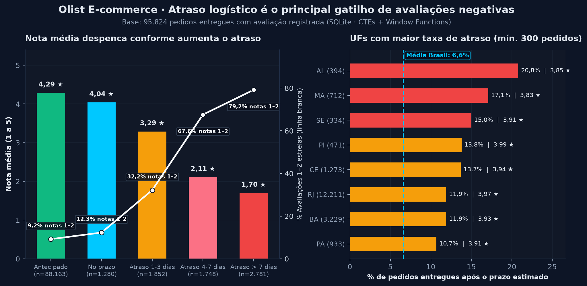
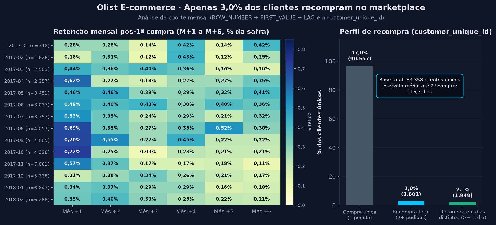
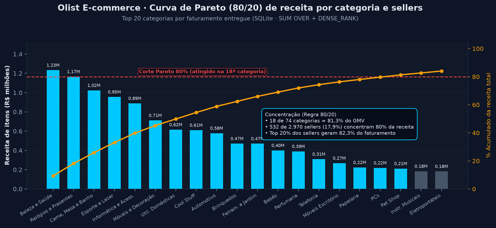

# Olist E-commerce — Análise de Retenção, Pareto e SLA em SQL

-003B57?logo=sqlite&logoColor=white)


Projeto de análise de dados em **SQL analítico** sobre o dataset público oficial **Brazilian E-Commerce Public Dataset by Olist** (99.441 pedidos reais entre 2016 e 2018). Responde a três perguntas de negócio usando **views relacionais sem fan-out, CTEs, Window Functions, análise de coortes e curva de Pareto**:

1. **Impacto do prazo na satisfação:** quanto o atraso logístico derruba a nota de avaliação e quais estados puxam o gargalo?
2. **Retenção e recompra:** qual é a taxa real de retorno dos clientes (`customer_unique_id`) mês a mês após a primeira compra?
3. **Concentração de receita (80/20):** quantos sellers e categorias concentram 80% do faturamento entregue?

> **Painel web interativo:** **[Abrir dashboard no navegador](https://natoawayrj.github.io/olist-sql-analytics/)** (filtros por região/UF, matriz de coorte, curva de Pareto e visualizador das queries SQL).

---

## Principais achados e recomendações

| Eixo analítico | Achado quantitativo (dados reais) | Recomendação de negócio |
|---|---|---|
| **SLA vs. Avaliação** | Em 95.824 pedidos entregues e avaliados, pedidos **antecipados** têm nota média **4,29 ★** (9,2% notas 1–2); com **atraso > 7 dias**, a nota despenca para **1,70 ★** e **79,2%** viram detratores (1–2 ★). | Recalibrar o prazo prometido no checkout e renegociar transportadoras nas UFs críticas — especialmente **RJ (11,9% de atraso em 12.211 pedidos)**, **BA (11,9%)** e Nordeste (**AL 20,8%**, **MA 17,1%**, **CE 13,7%**). |
| **Coortes & Retenção** | Dos **93.358 clientes únicos** com pedido entregue, **97,0% (90.557)** compraram uma única vez; apenas **3,0% (2.801)** recompraram e **2,1% (1.949)** voltaram em dias distintos (intervalo médio de **116,7 dias** até a 2ª compra). | Criar régua automatizada de recompra pós-entrega (janela D+30 a D+60) focada nas categorias de maior giro recorrente (`beleza_saude`, `perfumaria`, `pet_shop`), pois a retenção natural mensal fica abaixo de 0,72%. |
| **Pareto 80/20** | **532 de 2.970 sellers ativos (17,9%)** concentram **80% da receita** (`R$ 13,22 mi` no total); os **Top 20% dos sellers geram 82,3% do GMV**. Entre 74 categorias, **18 concentram 81,3%** (`beleza_saude` lidera com R$ 1,23 mi). | Estruturar conta-chave e suporte logístico prioritário para o grupo dos **~530 sellers âncora** que sustentam 80% do faturamento, reduzindo ruptura e atraso na ponta de maior impacto. |

---

## Visualizações geradas pelo pipeline





---

## Camada SQL e decisões técnicas

| Arquivo SQL | Técnicas aplicadas | O que resolve |
|---|---|---|
| [`sql/01_views_camada_analitica.sql`](sql/01_views_camada_analitica.sql) | `CTE` pré-agregada por `order_id`, `LEFT JOIN` seguro, `julianday()`, `CASE` | Cria `vw_pedidos_consolidados` e `vw_itens_entregues` **evitando fan-out** (pedidos com múltiplos itens, parcelas ou avaliações) e separando `customer_id` (pedido) de `customer_unique_id` (pessoa). |
| [`sql/02_coorte_retencao_recompra.sql`](sql/02_coorte_retencao_recompra.sql) | `ROW_NUMBER()`, `LAG()`, `COUNT() OVER`, `FIRST_VALUE()` | Calcula a taxa real de recompra, o intervalo em dias até a 2ª compra e a matriz de retenção mensal (M0 a M12) entre `2017-01` e `2018-08`. |
| [`sql/03_pareto_categorias_sellers.sql`](sql/03_pareto_categorias_sellers.sql) | `DENSE_RANK()`, `SUM() OVER (ROWS UNBOUNDED PRECEDING)`, `LAG()` | Constrói a curva de Pareto (80/20) de categorias e sellers e a variação mensal (MoM%) das Top 10 categorias. |
| [`sql/04_sla_entrega_vs_avaliacao.sql`](sql/04_sla_entrega_vs_avaliacao.sql) | `RANK() OVER`, `SUM() OVER`, `AVG() OVER`, `LAG()` | Mede a queda da nota por faixa de atraso e ranqueia as 27 UFs contra a média nacional (6,6% de atraso; nota 4,16). |

### Exemplo de query (Coorte & Janela de Recompra)

```sql
WITH sequencia_pedidos AS (
    SELECT
        customer_unique_id,
        order_id,
        order_purchase_timestamp,
        ROW_NUMBER() OVER (
            PARTITION BY customer_unique_id
            ORDER BY order_purchase_timestamp, order_id
        ) AS ordem_compra,
        LAG(order_purchase_timestamp) OVER (
            PARTITION BY customer_unique_id
            ORDER BY order_purchase_timestamp, order_id
        ) AS compra_anterior
    FROM vw_pedidos_consolidados
    WHERE order_status = 'delivered'
)
```

---

## Estrutura do repositório

```text
data/raw/*.csv  →  SQLite (olist.db)  →  sql/*.sql  →  data/processed/*.csv + img/*.png + docs/
```

| Caminho | Conteúdo |
|---|---|
| `sql/` | Views analíticas e consultas SQL comentadas (CTEs + Window Functions) |
| `scripts/run_pipeline.py` | Carga no SQLite, indexação, execução dos `.sql`, exportação e geração de gráficos |
| `data/processed/` | Tabelas agregadas geradas direto das queries SQL |
| `docs/` | Painel web interativo publicado via GitHub Pages |
| `tests/test_sql_pipeline.py` | Testes automatizados (`pytest`) validando volume, monotonicidade, Pareto e coortes |

---

## Como reproduzir localmente

1. Baixe os CSVs do dataset [Brazilian E-Commerce Public Dataset by Olist (Kaggle)](https://www.kaggle.com/datasets/olistbr/brazilian-ecommerce) para `data/raw/`.
2. Instale as dependências e execute o pipeline + testes:

```bash
python -m venv .venv
.venv\Scripts\activate      # Linux/macOS: source .venv/bin/activate
pip install -r requirements.txt
python scripts/run_pipeline.py
pytest -q
```

*(Observação: caso rode `pytest -q` sem os CSVs brutos baixados, a suíte valida automaticamente os agregados em `data/processed/` e a sintaxe dos arquivos `sql/`.)*

---

## Limitações do dataset

- **Janela temporal:** dados de pedidos entregues concentrados entre `2017-01` e `2018-08` (meses de 2016 e set–out/2018 são parciais e ficaram fora da matriz mensal).
- **Dinâmica de marketplace:** muitos clientes compram em lojas específicas dentro do ecossistema sem reconhecer a Olist como marca única, o que explica parte da baixa taxa de recompra observada (3,0%).
- **Prazo estimado:** `order_estimated_delivery_date` vem com hora `00:00:00`; por isso, o atraso foi calculado por data calendário (`date(...)`), tratando entregas no próprio dia prometido como **no prazo**.

---

**Renato Santos** · [Portfólio](https://natoawayrj.github.io/) · [LinkedIn](https://www.linkedin.com/in/renato-santos-dados/) · [GitHub](https://github.com/natoawayrj)
